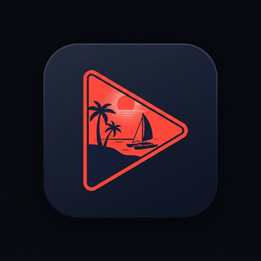

<p align="center">
  
</p>

<h1 align="center">zanzibarr</h1>

<p align="center"><strong>Your Usenet player. Open an NZB. Start watching. Seek freely.</strong></p>

<p align="center">A native Flutter player with a Rust streaming engine, integrated indexer search,<br>archive support and a library that remembers where you left off.</p>

<p align="center">
  <a href="https://github.com/P-Sivakumaran/zanzibarr/actions/workflows/verify.yml"></a>
  <a href="https://github.com/P-Sivakumaran/zanzibarr/releases"></a>
  
  <a href="https://github.com/P-Sivakumaran/zanzibarr/stargazers"></a>
</p>

<p align="center">
  <a href="#get-started">Get started</a> · <a href="#features">Features</a> ·
  <a href="#platforms-and-release-status">Platforms</a> ·
  <a href="#build-from-source">Build</a> · <a href="#contribute">Contribute</a>
</p>

zanzibarr plays video from Usenet without waiting for the entire release to
download. Open an NZB or find a release through your indexers, then watch through
a seekable local stream. The engine fetches and decodes segments on demand;
archive handling and repair can use temporary disk space.

This is **Prashanth's fork of [envermeister/zanzibarr](https://github.com/envermeister/zanzibarr)**,
focused on multi-indexer search, optional metadata, library management and
repeatable packaging. You supply your own Usenet provider account and NZB sources.

## Features

| Feature | What you can do |
|---|---|
| **On-demand streaming** | Start before a full download completes and seek through byte-range requests backed by decoded yEnc offsets. |
| **Multi-indexer search** | Configure Newznab-compatible sources, inspect release details and use structured movie/episode searches. |
| **Optional metadata** | Look up titles and available ratings with your own OMDb key. Search and playback work without it. |
| **Continue watching** | Resume titles, recover expired temporary NZBs from their original source, and keep favorites independent of watch progress. |
| **Show tracking** | Track shows, request new-episode checks and open suggested next-episode searches. Checks are user-triggered. |
| **Archive playback** | Handle supported RAR4/RAR5 and split 7z releases, including supported compressed/encrypted paths. Some paths use temporary storage. |
| **PAR2 recovery** | Trigger repair from a playback error and resume using repaired data when enough recovery blocks are available. |
| **Playback controls** | Select audio/subtitle tracks, adjust speed and sync, choose picture presets, and crop with Smart Canvas. |
| **HDR and Dolby Vision paths** | Use supported decode and tone-mapping paths; results depend on your device, platform and media libraries. |
| **Desktop and TV interfaces** | Dark/light themes, localized interfaces and Android TV focus navigation. New fork copy can fall back to English. |

Archive compatibility is not universal; a reported RAR4 parsing issue remains
under investigation. Device playback, casting and accessibility checks for the
latest candidate are still pending. See the [release notes](docs/releases/v1.10.md).

## Get started

1. Check the [fork releases](https://github.com/P-Sivakumaran/zanzibarr/releases)
   for an available package. Use only assets actually attached to a published release.
2. Open **Settings** and enter your provider's NNTP host, port and credentials.
   Application credentials use the operating system's secure storage.
3. Open an `.nzb` file and select the media to play. Optionally add your indexers
   to search from inside the app.

**Windows:** use the setup `.exe` for a per-user installation, or extract the
entire portable `.zip` and run `zanzibarr.exe` alongside its DLLs and `data` folder.
The executable is not a standalone single-file application.

## Platforms and release status

The current local candidate is **1.10.0+11**. A local build does not imply a
published GitHub release or validation on every platform.

| Platform | Packaging and current requirements |
|---|---|
| **Windows x64** | Setup and portable ZIP built locally. Unsigned. Fresh-user/VM installation and live playback checks remain pending. |
| **Ubuntu 24.04 x64** | CI packaging for `.deb` and `.tar.gz`; requires system GTK, libmpv and secret service. Fork CI validation remains pending. |
| **Android / Android TV** | CI packaging for universal and ABI APKs; requires persistent release-signing secrets and device checks. |
| **iOS** | CI packaging for an unsigned IPA; signing/provisioning and device validation are separate requirements. |
| **macOS arm64** | Requires a Mac, compatible media frameworks and signing/notarization work. No current fork package is claimed. |
| **Web** | Unsupported: the engine depends on native networking and libraries. |

Read the [v1.10 notes](docs/releases/v1.10.md) and [release runbook](docs/RELEASING.md)
for verification results. Published assets are the source of truth for downloads;
upstream releases are separate from this fork.

## How it works

```text
NZB file / indexer search
          |
Rust: NNTP pool -> yEnc decode + CRC checks -> archive / repair layer
          |
Local HTTP stream with byte-range support
          |
Flutter UI + media_kit / libmpv
```

Rust handles networking, decoding, archives and streaming. Flutter provides the
interface through `flutter_rust_bridge`. Seeking uses decoded segment positions,
rather than treating encoded NZB byte counts as video offsets.

Playback runs locally. Provider, indexer, optional OMDb and update requests
connect to their respective services; casting also serves a token-gated stream
on your local network. No zanzibarr account is required.

## Build from source

Use **Flutter 3.44.6**, its bundled Dart SDK, Rust and native build tools for your
target. Windows requires Visual Studio's C++ desktop tools. Linux instructions:
[BUILDING.linux.md](docs/BUILDING.linux.md).

```sh
git clone https://github.com/P-Sivakumaran/zanzibarr.git
cd zanzibarr
flutter pub get
flutter gen-l10n
flutter run -d windows
```

Replace the device with your supported target (`flutter devices` lists available
devices). Build a Windows release with `flutter build windows --release`.
Run verification from the repository root:

```sh
cargo test --locked --manifest-path rust/Cargo.toml
cargo clippy --locked --manifest-path rust/Cargo.toml --all-targets -- -D warnings
flutter analyze --no-pub lib test
cargo build --locked --manifest-path rust/Cargo.toml
flutter test --no-pub
git diff --check
```

The host Rust build provides the native library used by bridge tests. If parallel
socket tests encounter resource errors on Windows, rerun Rust tests with
`-- --test-threads=1` and record both results. Installer commands, checksums and
signing requirements are in [RELEASING.md](docs/RELEASING.md).

## Contribute

Useful contributions include reproducible archive failures, playback reports,
platform testing, accessibility feedback and focused fixes. Include your OS,
app version, reproduction steps and sanitized diagnostics in a pull request.
Remove credentials, private URLs and copyrighted media from shared material.

Start with [AGENTS.md](AGENTS.md) for engineering rules and verification.
For questions while Issues is disabled, use contact options on the
[maintainer's GitHub profile](https://github.com/P-Sivakumaran).

**If zanzibarr is useful to you, give the repository a star.** It helps other
Usenet users discover the project. Testing a candidate and sharing actionable
feedback also helps move releases forward.

## Credits

Created upstream by [envermeister](https://github.com/envermeister/zanzibarr),
with this fork maintained by [Prashanth Sivakumaran](https://github.com/P-Sivakumaran).
Built on Flutter, Rust, flutter_rust_bridge, media_kit/libmpv and the archive and
repair libraries credited in the source and packaged notices. Preserve those
notices when redistributing builds.

Use content you are entitled to access and follow your provider's terms.
