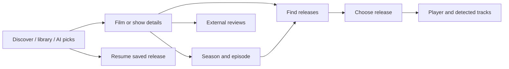

# Artwork, title browsing and language experience

Status: **design specification and clickable study**, 19 October 2026.
Core title/library, OMDb artwork/episode and media-language functionality is now
implemented in the 1.18 candidate; see the [implementation and verification
handoff](METADATA_LIBRARY_IMPLEMENTATION_2026-10-19.md) for delivered scope and
remaining proposals. The study below remains illustrative. The pre-existing
uncommitted 1.17 film/TV chat work is preserved.

Open the [interactive study](design/metadata-explorer.html) in a browser. It is
self-contained apart from the existing local logo: no APIs, credentials,
remote artwork, analytics or playback. Titles, ratings, tracks and episode
information are fictional; CSS illustrations demonstrate artwork placement.
App-language controls demonstrate the settings structure, not translations.

Rendered studies: [Discover](design/metadata-browse.png),
[show and episodes](design/metadata-title.png),
[release languages](design/metadata-releases.png),
[narrow language settings](design/metadata-narrow.png).

## Product direction

Make a film or show the primary browsing unit. Release filenames belong one
level deeper, after someone chooses a title and, for TV, an episode. Preserve
direct NZB/open-file and raw indexer search as accessible routes.

The user asked for release artwork, an app-language selector, audio/subtitle
language flags, an organised Stremio-style show experience, IMDb/RT scores and
review links. Interpret artwork as title posters, backdrops and episode stills,
reused by the matched releases. Never attach a guessed poster to an ambiguous
release without resolving its title identity.

Recommended first journey:

## Current capabilities and gaps

| Area | Existing seam | Design change |
|---|---|---|
| App language | `lib/settings/ui_preferences.dart:8`, `settings_screen.dart:721`: 14 native-name locale options, persisted runtime controller | Expose **Settings → Language & region** more clearly. Reuse it; add System default only with explicit migration/fallback semantics. |
| Metadata | `lib/metadata/metadata_service.dart:36`: IMDb ID, type, title/year, plot, genre, runtime and source-labelled ratings | Add optional artwork, credits, certification, original languages, source/freshness, external links and provider IDs. |
| Details | `metadata_screen.dart:605`: private 480px title dialog, ratings, IMDb link, tracking and release search | Extract a reusable responsive title page; keep current search/tracking actions. |
| Plugins | `lib/integrations/metadata_plugin.dart:8`: OMDb-compatible search/details with IMDb identity checks | Add optional rich fields compatibly. No second competing lookup system. |
| TV state | `lib/player/watchlist.dart`, `playback_history.dart`, `up_next.dart` | Merge an authoritative episode catalog with local watched/resume state. Existing next-integer heuristic cannot establish season boundaries. |
| Search identity | `lib/search/release_search_selection.dart` | Preserve confirmed IDs, kind and episode through source search and pagination. |
| Media languages | `player_screen.dart:378/559`, `gyuni_player_controls.dart:1264` | Normalise actual player-track language codes, retaining unknown values and track titles. |
| Before playback | `rust/src/api/search.rs:60`, `engine/newznab.rs:500`: no release-language DTO fields | Unknown unless an indexer supplies usable evidence. Codec/channel labels are not language evidence. |
| AI cards | `lib/chat/film_playlist.dart` in current 1.17 work | Resolve title/year/kind against metadata; allow correction. AI cannot establish verified IDs, scores, artwork or available tracks. |

The existing language selector and rating parser should be improved rather than
rebuilt. The main structural gap is a common title page shared by search, AI,
library, tracking and continue-watching.

## Screen and interaction specification

### Discover and library

- Keep Zanzibarr branding and warm coral accent. Use quiet dark surfaces and
  artwork as the visual hierarchy. Do not copy Stremio's logo, assets or code.
- Navigation: Discover, My library, Ask AI, Settings. Keep raw release search and
  Open NZB visible in the shipping application; the study focuses on discovery.
- First row: continue watching, with title/episode, progress and **Resume**.
  Resume targets the existing saved release identity and playhead, not a new
  search result with a similar name.
- Follow with saved/watchlist titles, tracked shows and explicit AI collections.
  Films/TV filters and title/year/genre sorting should operate on the displayed
  collection. Provider-backed trending/genre catalogs are a later optional step.
- Poster ratio 2:3, episode still 16:9. Keep title/year outside the artwork as
  selectable/accessibility text. Missing art uses a stable title placeholder;
  loading images never change card size or block actions.
- A compact rating may appear below a poster. Full source labels and missing
  values belong on details; do not cram every score and language onto artwork.

### Film/show details

- Desktop: poster + title/year/type/certification/genres/runtime + short
  synopsis + IMDb/RT ratings + primary action. Optional backdrop stays behind a
  strong readability scrim. Cast, creators, studios, country, original language,
  awards and source attribution move into About with progressive disclosure.
- TV: Seasons → episodes, with number/name/runtime/air date and watched/resume
  state. Specials are Season 0. Support absent dates, missing numbers, multipart
  episodes, unreleased episodes and different ordering; do not infer next season
  from `episode + 1`. Preserve spoiler preferences for stills and synopses.
- Films: Find releases. TV: choose an episode then Find releases. Offer Resume
  only for a known saved playable entry. A catalog entry is not proof of an
  available release. Distinguish Not aired, Not checked and No releases found.
- Full-page navigation on desktop, stacked layout on phones and a large-focus
  TV layout. Preserve scroll position and keyboard/D-pad focus on Back.
- AI results, metadata search, library and tracked shows converge here; show
  alternate title matches and a **Wrong title?** correction path.

### Ratings and reviews

- Show IMDb as `/10` and Rotten Tomatoes with the supplied `%` scale. Source:
  **IMDb via OMDb**, **Rotten Tomatoes via OMDb**. Record fetch time; show stale
  cached data honestly. Do not equate RT with TMDB user votes.
- RT audience and critics scores are distinct metrics. Only label critics or
  audience when the provider contract identifies the metric; a generic source
  label must remain generic. The study's critics label is illustrative, not a
  claim that every existing OMDb value includes metric classification.
- IMDb destination uses the confirmed IMDb ID. Exact RT destination requires a
  verified provider mapping, never a title-generated slug. Otherwise offer
  **Search Rotten Tomatoes**, clearly labelled as search. Open externally.
- Review text and reviewer attribution are optional later enrichment from a
  provider that supplies them; linking to a review is the first delivery.
  Missing score/link is **Not available**, never 0 or a fabricated URL.

### Four separate language choices

1. **App language:** reuse current translations, native names and persisted
   selection; show English fallback for untranslated fork copy. A future System
   default follows OS changes and resolves to a supported locale.
2. **Metadata language:** initially Match app language; provider fallback to
   original/English where appropriate. Never translate titles by inventing IDs.
3. **Preferred audio:** ordered language preference, original/default fallback,
   manual override. Selection happens only after matching actual tracks.
4. **Preferred subtitles:** Off or language preference; forced subtitles and
   accessibility/SDH are independent options. Do not silently turn SDH into a
   different language or ignore a manual choice.

Use language names/codes as primary indicators: **Audio · English**, **Sub ·
Français**, **CC · English · SDH**, plus forced/audio-description markers when
present. An optional regional flag may accompany a known region, such as
English (US). Do not map `en` to a US/UK flag or `es` to Spain by default. The
user's visual preference is still open; the study exposes a flag option.

Track evidence has three states: **Detected** from the opened media, **Reported**
by the source, **Unknown**. Show title original languages in About, separately.
External subtitle files are identified separately from embedded tracks. A
language appearing in a title's metadata does not establish that a release has
that audio or subtitle track. Avoid probing every release just to populate badges.

## Provider strategy and performance

Recommended pairing: optional TMDB for posters/backdrops, localized title data,
credits and seasons/episodes; reuse optional OMDb for source-labelled IMDb/RT
ratings. This is a proposal, not a configured provider or guaranteed field set.

Official sources checked 19 October 2026:

- [TMDB API FAQ](https://developer.themoviedb.org/docs/faq): images/data access,
  non-commercial developer use and required attribution. Include the approved
  logo and prescribed notice in About; confirm appropriate access before shipping.
- [Image construction](https://developer.themoviedb.org/docs/image-basics) and
  [language fallbacks](https://developer.themoviedb.org/docs/image-languages):
  request sized images and appropriate image-language fallback.
- [Season details](https://developer.themoviedb.org/reference/tv-season-details),
  [TV external IDs](https://developer.themoviedb.org/reference/tv-series-external-ids)
  and [TV reviews](https://developer.themoviedb.org/reference/tv-series-reviews):
  candidate endpoints; verify actual responses under the selected access plan.
- [OMDb](https://www.omdbapi.com/): reuse existing API access. Its separate
  high-resolution Poster API is patron-only; do not assume it is included.

Keep normalized provider IDs and per-field provenance. Provider ID namespaces
must not collide; title matching includes type/year and user correction. Track
artwork/provider source and locale in cache keys. Do not send indexer credentials,
release URLs or viewing history to metadata services.

The current metadata implementation is explicitly requested, bounded to 15s /
1MiB JSON, caches at most 100 entries for six hours, coalesces requests and clears
credential-dependent state on key changes. Preserve these properties. Enabling
automatic enrichment should be an explicit setting explaining remote requests;
do not silently turn every release row into an external title lookup.

Proposed image defaults to measure: 200MiB on-disk LRU, 14-day TTL; 4 concurrent
image requests; at most 3 visible title-enrichment requests; 5MiB response cap
and 8-megapixel source cap before decode. Request 342/500px posters for cards,
decode near rendered size and avoid original-size backdrops. Enforce URL scheme,
public-host/redirect rules, content type, decode limits, timeout/cancellation,
private-network protection and no credential-bearing URLs. These are initial
budgets, not benchmark results. Clear/disable artwork independently of playback.

Lazy-load visible cards and selected seasons, coalesce identical requests,
discard stale query/locale results and retain text fallbacks during provider
errors or quota limits. Do not refetch metadata on every frame or keystroke.

## Delivery sequence and acceptance

| Phase | Scope | Acceptance evidence |
|---|---|---|
| 1 — Rich title foundation | Add optional model/plugin fields, confirmed identity, bounded artwork loading, reusable cards/full details, source-labelled ratings and external review actions; improve existing app-language entry | Old plugin objects still parse; wrong identities do not attach art; absent/offline data has usable fallbacks; no key leaves search/playback functional; links are validated. |
| 2 — Organised shows | Provider season/episode catalog merged with existing history/tracking; watchlists and AI enter the same title page | Specials, season transitions, future/missing episodes, duplicate titles and resume identity covered; finding an episode searches its exact kind/identity. |
| 3 — Languages | Normalised player tracks, truthful evidence badges, preferred audio/subtitles and optional region flags | ISO aliases/unknown tags, multilingual releases, forced/SDH/external subs, manual overrides and settings persistence covered; no invented pre-playback flags. |
| 4 — Discovery polish | Poster shelves, library filters/sort, cast/genre exploration, optional catalogs and richer reviews | Bounded requests/cache/memory and measured scrolling on target hardware; no provider permission/data assumptions. |

All shipping phases need the repository's ordered Rust/Flutter gate. Extend
metadata service/screen, plugin, history/up-next, structured-search and player
track regressions. UI acceptance includes 360px/200% text, RTL, visible focus,
44–48px targets, keyboard/D-pad traversal, stable image placeholders and a
screen-reader label containing title/type/year. Test on physical TV/phone before
claiming those platforms complete. No full application gate was rerun for this
documentation/prototype-only task.

## Reference study and verification boundaries

The installed Windows registration identifies **Stremio 4.4.181** at
`C:\Users\prash\AppData\Local\Programs\LNV\Stremio-4\stremio.exe`.
REA PE-resource inspection observed a 307688-byte PE32 artifact, SHA256
`0ac44c712bd89c19a347f488ee14b5187d2d34d5fedf7aec1ed9b2176ab80ce2`.
Evidence ID: `ev_254482157431bc545a11d1d6a5f9f00ac09a84f400a13c9ae33b303fafb801c7`.
Ordinary directory inventory also found Qt5/QtWebEngine components and server.js.
This establishes installation identity, not observed title-page behavior.

The connected REA server reports native UI observation/capture **unsupported on
Windows** (macOS-only). No Stremio account/profile was inspected or changed and
no playback was started. The [official Stremio web UI repository](https://github.com/Stremio/stremio-web)
documents catalog discovery, library/continue watching, subtitles, keyboard
control and localization. It is a separate reference, not proof of the installed
4.4.181 runtime. Its linked screenshots could not be fetched through the web
tool. Exact installed layout and runtime behavior remain unverified.

The prototype was rendered in an isolated Chrome session via REA, with no user
profile. Desktop title filters, show details, season selection and review-dialog
navigation were exercised; a non-unique test locator was corrected before the
release-track walkthrough completed. No page-error events were recorded in
those completed paths. Narrow-screen language settings and the provider-error
fallback were exercised separately. This is design-study evidence, not Flutter
implementation or a complete accessibility audit.

Evidence exports and bulky render data stay under ignored `dist/audit/`.
Screenshots under `docs/design/` show the study, not real catalog assets.

Final completed REA browser paths (no page-error events):

| Path | Evidence ID |
|---|---|
| Show / keyboard tabs / episodes | `ev_a0494c43620847a6214bb06f0f7dc4a7cf7fb9a90960a82a193dc9c649f24e3d` |
| Episode release / detected-track example | `ev_9f137e7ffcdab3a99cd9ee44821ebb29c92b32a9e9f73dac5db1373f56bcd341` |
| 390px reviews / Escape / settings | `ev_4cd180c5aa0ef7f71bc1e8d2e5544fbc5c74fd9df083d9d4b3e31dc9d2fbd950` |
| Library / show / Back / Discover | `ev_1934d1c38909c6ab96c47b0b9159add6bb63d87f7f0476db9bf038fe52771292` |

JavaScript syntax, unique HTML IDs, local prototype links and `git diff --check`
passed. Desktop/title/narrow screenshots were inspected visually. These checks
do not establish WCAG conformance, production provider correctness or physical
D-pad behavior. The test-only local server was stopped after validation; open
the standalone HTML directly for review.
